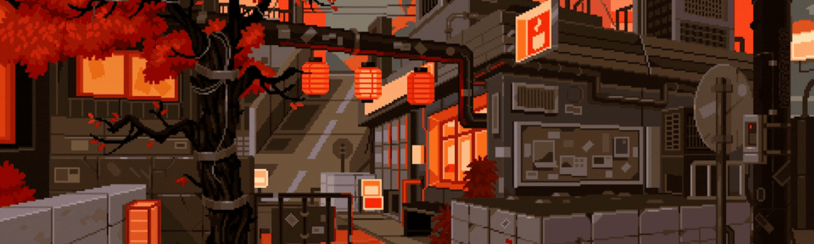
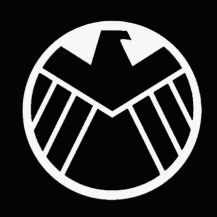
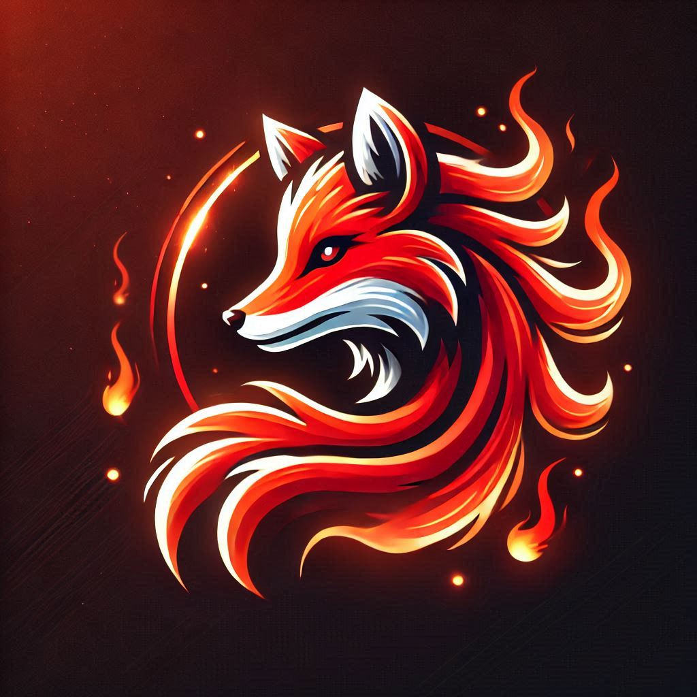
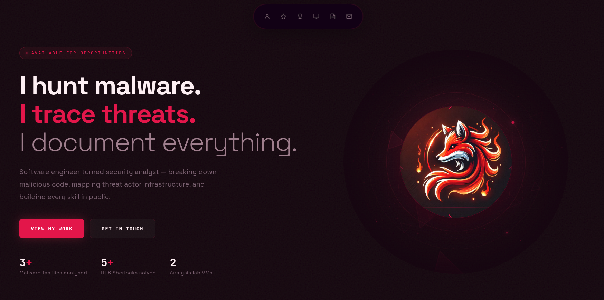

<div align="center">
  
# 

##
  
  <span style="color:#00eaff; font-weight:700;">
    "The only way. The Hacker Way"
  </span>
  

</div>

---


---

<div align="center">
    
# 👋 About Me 👋

</div>

<picture>
<a href="https://github.com/AminePY" alt="Developer">

</a>
</picture>

Hi there! I'm **Amine Ben Amara**, a cybersecurity graduate and **Blue Team / SOC Analyst** in training, based in Tunisia 🇹🇳. I'm building toward a career in **malware analysis** and **threat intelligence**, with a Software Engineering background that shapes how I think about defense. \
**★ Certifications Roadmap :** \
🟩🟩🟨⬜⬜ **CompTIA Security+** — In Progress \
⬜⬜⬜⬜⬜ **BTL1** (Blue Team Level 1) — Planned \
⬜⬜⬜⬜⬜ **eJPT** (Junior Penetration Tester) — Planned \
My focus right now: **SIEM analysis**, **log investigation**, and **malware behavioral analysis** in my home lab (REMnux + FlareVM), alongside **OSINT** — tracing indicators and building investigative methodology. \
★ Reach me via **Connect with Me** below!

<br clear="left"/> 

<div align="center">

### ✨ My Portfolio Website ✨

<a href="https://aminepyc.github.io/Portfolio-Website/" alt="Portfolio Projects">

</a>

</div>

---


---

<div align="center">

## 🧑‍💻 Frequently Used Tech 🧑‍💻

</div>

<p align="center">
  
  <br>
   
  <br>
  
</p>

<p align="center">
  
  
</p>

---


---

<div align="center">

**I am Nighty Person 🦉** 

```text
🌞 Morning                200 commits         ███░░░░░░░░░░░░░░░░░░░░░░   8.50 % 
🌆 Daytime                1000 commits        █████████░░░░░░░░░░░░░░░░   42.50 % 
🌃 Evening                800 commits         ████████░░░░░░░░░░░░░░░░░   34.00 % 
🌙 Night                  350 commits         ████░░░░░░░░░░░░░░░░░░░░░   14.88 % 
```


 Last Updated on 01-12-2025 UTC


</div>

---


---

<div align="center">

### 🤝 Connect with Me 🤝

[](https://www.linkedin.com/in/amine-ben-amara-539353246)
[](https://www.instagram.com/aminear001)
[](https://discord.com/users/holmes5732)
[](https://github.com/AminePYC)

</div>

---


---

<div align="center">
    Made with ❤️ by <a href="https://github.com/AminePYC" target="_blank">Amine Ben Amara</a>
</div>
